# SekawanFleet

Aplikasi web pemesanan dan monitoring kendaraan untuk perusahaan tambang nikel yang memiliki satu kantor pusat, satu kantor cabang, dan enam lokasi tambang. Admin (pool kendaraan) menginput pemesanan, menentukan driver dan approver berjenjang. Approver (atasan) menyetujui lewat aplikasi. Setelah kendaraan kembali, admin mencatat odometer dan BBM sebagai riwayat pemakaian.

Dibuat untuk Technical Test Fullstack Developer (Intern).

## Daftar Isi

- [Fitur](#fitur)
- [Teknologi & Versi](#teknologi--versi)
- [Akun Demo](#akun-demo)
- [Instalasi](#instalasi)
- [Panduan Penggunaan](#panduan-penggunaan)
- [Screenshot](#screenshot)
- [Aturan Bisnis](#aturan-bisnis)
- [Physical Data Model](#physical-data-model)
- [Activity Diagram](#activity-diagram)
- [Log Aplikasi](#log-aplikasi)
- [Pengujian](#pengujian)
- [Batasan](#batasan)

## Fitur

| Ketentuan soal | Implementasi |
|---|---|
| a. Dua jenis user (admin & pihak yang menyetujui) | Role `admin` dan `approver`, menu dan hak akses dipisah per role |
| b. Admin menginput pemesanan, menentukan driver dan approver | Form pemesanan: pemohon, keperluan, tujuan, jadwal, kendaraan, driver, dan approver per level. Dilengkapi cek bentrok jadwal kendaraan & driver |
| c. Persetujuan berjenjang minimal 2 level | 2 sampai 5 level, approver tiap level harus orang yang berbeda. Level berikutnya baru aktif setelah level sebelumnya menyetujui |
| d. Persetujuan melalui aplikasi | Menu **Persetujuan Saya**: setujui (catatan opsional) atau tolak (alasan wajib) |
| e. Dashboard grafik pemakaian kendaraan | KPI bulan ini, grafik pemakaian per bulan, top 10 kendaraan, komposisi status, jenis angkutan (milik/sewa), konsumsi BBM & jarak tempuh. Filter lokasi dan periode 3/6/12 bulan |
| f. Laporan periodik + export Excel | Filter periode, status, jenis kendaraan, lokasi. Export `.xlsx` berisi sheet *Pemesanan* (detail) dan *Ringkasan* |
| g. README | Dokumen ini |

| Poin tambahan | Implementasi |
|---|---|
| a. Physical data model | [Physical Data Model](#physical-data-model) |
| b. Activity diagram | [Activity Diagram](#activity-diagram), 10 diagram per aktor ditambah siklus status |
| c. Log aplikasi pada tiap proses | Login/logout, pemesanan, persetujuan, pembatalan, pengembalian, jadwal servis, export laporan, dan perubahan data armada. Tersimpan di database dan file harian, dan bisa dilihat di menu **Log Aktivitas** |
| d. UI/UX baik & responsive | Layout sidebar yang berubah menjadi drawer di layar < 1024 px, badge status, timeline persetujuan, dan pesan validasi berbahasa Indonesia |

Fitur tambahan:

- **Pengembalian kendaraan**: pencatatan odometer, BBM, dan catatan kondisi yang menutup alur pemesanan sampai status `completed`. Data ini dipakai grafik BBM & jarak tempuh.
- **Monitoring kendaraan & jadwal servis**, sesuai deskripsi soal ("konsumsi BBM, jadwal service dan riwayat pemakaian kendaraan"):
  - Menu **Kendaraan** berisi daftar armada dengan odometer terakhir, jumlah perjalanan, jarak, BBM (km/L), dan servis berikutnya.
  - Halaman detail tiap kendaraan berisi pemakaian 6 bulan, riwayat pemakaian, pemesanan mendatang, serta jadwal & riwayat servis.
  - Admin bisa menjadwalkan servis (berkala, perbaikan, inspeksi/KIR), menandainya selesai (odometer, biaya, bengkel), atau membatalkannya.
  - Servis yang terlambat atau jatuh tempo dalam 7 hari ditandai di daftar kendaraan, badge menu, dan dashboard admin.

## Teknologi & Versi

| Komponen | Versi |
|---|---|
| PHP | 8.3.30 |
| Framework | Laravel 13.36.0 |
| Database | PostgreSQL 18.6 (ekstensi `btree_gist`) |
| Node.js / npm | 24.15.0 / 11.12.1 |
| Composer | 2.9.4 |
| Autentikasi | Laravel Breeze 2.4.2 (Blade) |
| Export Excel | maatwebsite/excel 4.0.4 |
| Activity log | spatie/laravel-activitylog 4.12.3 |
| Frontend | Blade, Tailwind CSS 3.4.19, Alpine.js 3.17.4, Chart.js 4.5.1, Vite 8.3.4 |

Versi minimum: PHP ≥ 8.3 dan PostgreSQL yang menyediakan ekstensi `btree_gist`. Ekstensi ini sudah termasuk dalam instalasi standar PostgreSQL.

## Akun Demo

Semua akun memakai password **`password`**.

| Role | Nama | Jabatan | Email |
|---|---|---|---|
| Admin | Admin Pool | Staff Pool Kendaraan | `admin@nikel.test` |
| Approver | Budi Supervisor | Supervisor Operasional | `supervisor@nikel.test` |
| Approver | Sari Manager | Manager Operasional | `manager@nikel.test` |
| Approver | Andi Kepala Site | Kepala Site | `kasite@nikel.test` |
| Approver | Rina GM | General Manager | `gm@nikel.test` |

Aplikasi hanya memiliki **2 role**: admin dan approver. Akun approver dibuat lebih dari satu karena setiap level persetujuan harus disetujui orang yang berbeda. Satu pemesanan butuh minimal 2 approver, dan dengan 4 approver bisa diperagakan persetujuan sampai 4 level. Jabatan hanya label, dan approver mana pun bisa dipilih di level mana pun.

Registrasi publik dinonaktifkan. Akun dibuat lewat seeder.

## Instalasi

### 1. Clone dan install dependency

```bash
git clone https://github.com/stevenchristm/SekawanFleet.git
cd SekawanFleet
composer install
npm install
```

### 2. Konfigurasi environment

```bash
cp .env.example .env        # Windows: copy .env.example .env
php artisan key:generate
```

Sesuaikan koneksi database di `.env`:

```env
DB_CONNECTION=pgsql
DB_HOST=127.0.0.1
DB_PORT=5432
DB_DATABASE=sekawan_fleet
DB_USERNAME=postgres
DB_PASSWORD=
```

### 3. Buat database

```sql
CREATE DATABASE sekawan_fleet;
CREATE DATABASE sekawan_fleet_test;  -- hanya untuk menjalankan test
```

Migration menjalankan `CREATE EXTENSION IF NOT EXISTS btree_gist`. Gunakan user database yang berhak membuat ekstensi, misalnya `postgres`, atau aktifkan ekstensi tersebut lebih dulu di kedua database.

### 4. Migrasi, data demo, dan build

```bash
php artisan migrate --seed
npm run build
php artisan serve
```

Buka http://localhost:8000 lalu login dengan salah satu [akun demo](#akun-demo).

Untuk mereset data demo, jalankan `php artisan migrate:fresh --seed`. Jangan lupa `--seed`: tanpa opsi itu semua tabel kosong dan tidak ada akun untuk login.

### Data demo

Seeder membuat 8 lokasi di 5 region (Kantor Pusat Jakarta, Kantor Cabang Palu, dan 6 site tambang: Morowali, Kolaka, Pomalaa, Konawe, Halmahera, Sorowako), 10 kendaraan (angkutan orang & barang, milik perusahaan & sewaan dari 2 perusahaan rental), 7 driver, sekitar 135 pemesanan selama 6 bulan terakhir dengan semua status serta persetujuan 2-3 level, dan contoh isi log aktivitas.

Beberapa pemesanan berstatus *Disetujui* dengan waktu mulai yang sudah lewat, sehingga fitur **Catat Pengembalian** bisa langsung dicoba.

Setiap kendaraan juga punya riwayat servis selesai selama 6 bulan terakhir dan satu servis terjadwal. Sebagian sudah terlambat, sebagian jatuh tempo minggu ini, dan sisanya masih lama, sehingga semua penanda servis langsung terlihat.

## Panduan Penggunaan

### Admin (`admin@nikel.test`)

1. **Dashboard**: lihat KPI dan grafik pemakaian kendaraan. Saring per lokasi atau periode (3/6/12 bulan).
2. **Membuat pemesanan**: buka menu **Pemesanan → Buat Pemesanan**.
   1. Isi nama pemohon (pegawai), keperluan, tujuan, waktu mulai & selesai.
   2. Pilih kendaraan dan driver.
   3. Pilih approver untuk level 1, level 2, dan seterusnya (minimal 2, maksimal 5, orang berbeda).
   4. Klik **Simpan**. Pemesanan berstatus *Menunggu* dan masuk ke inbox approver level 1.
3. **Memantau pemesanan**: menu **Pemesanan** menampilkan tab status beserta jumlahnya, filter lokasi, dan pencarian (kode, pemohon, tujuan, plat nomor). Halaman detail menampilkan timeline persetujuan per level.
4. **Membatalkan**: di halaman detail, klik **Batalkan Pemesanan**. Tombol ini hanya tersedia untuk status *Menunggu* atau *Disetujui*.
5. **Mencatat pengembalian**: setelah kendaraan kembali, buka detail pemesanan yang *Disetujui*, klik **Catat Pengembalian**, lalu isi odometer akhir, BBM (liter), waktu kembali, dan catatan. Odometer awal terisi otomatis dari pengembalian terakhir kendaraan tersebut. Status berubah menjadi *Selesai*.
6. **Laporan**: menu **Laporan** → atur periode dan filter → **Tampilkan** → **Export Excel**.
7. **Kendaraan & jadwal servis**: menu **Kendaraan** menampilkan semua armada. Klik kartu *Servis terlambat* atau *Servis 7 hari ke depan* untuk menyaring. Di halaman detail kendaraan:
   1. **Jadwalkan Servis**: pilih jenis (berkala, perbaikan, inspeksi/KIR), tanggal, dan bisa juga target odometer, bengkel, serta rencana pekerjaan.
   2. **Tandai Selesai**: isi tanggal selesai, odometer saat servis (tidak boleh lebih kecil dari odometer terakhir), biaya, dan catatan pekerjaan. Hasilnya pindah ke *Riwayat Servis*.
   3. Ikon kalender silang membatalkan jadwal servis.
8. **Log Aktivitas**: menu **Log Aktivitas**, bisa disaring per kategori, pengguna, tanggal, atau kata kunci.

### Approver (`supervisor@nikel.test`, `manager@nikel.test`, `kasite@nikel.test`, `gm@nikel.test`)

1. **Dashboard**: KPI pribadi (menunggu persetujuan saya, disetujui & ditolak bulan ini) dan grafik pemakaian kendaraan.
2. **Persetujuan Saya**: berisi pemesanan yang sedang menunggu giliran approver tersebut. Jumlahnya tampil sebagai badge di menu.
   - **Setujui**: catatan opsional. Kalau masih ada level berikutnya, pemesanan diteruskan ke approver level itu. Kalau ini level terakhir, status menjadi *Disetujui*.
   - **Tolak**: alasan wajib diisi (tersedia tombol alasan cepat). Status menjadi *Ditolak*, dan level berikutnya tidak perlu memproses lagi.
3. Tab **Riwayat** berisi pemesanan yang sudah disetujui atau ditolak oleh approver tersebut.
4. Approver hanya bisa bertindak pada gilirannya. Pemesanan dengan level 1 yang belum diputuskan belum muncul di inbox approver level 2.

Approver yang dipilih di data demo diacak. Kalau inbox satu approver kosong, coba login dengan approver lain.

## Screenshot

### Login

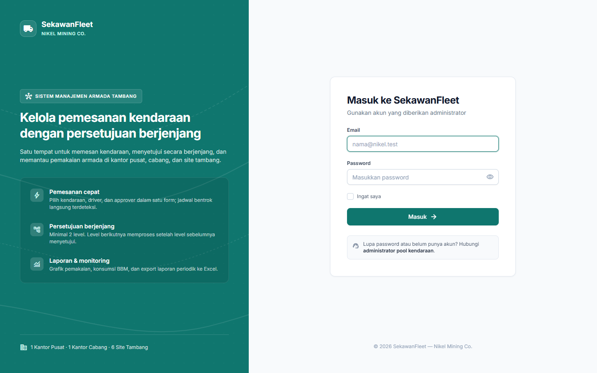

### Admin

| Dashboard | Daftar Pemesanan |
|---|---|
| 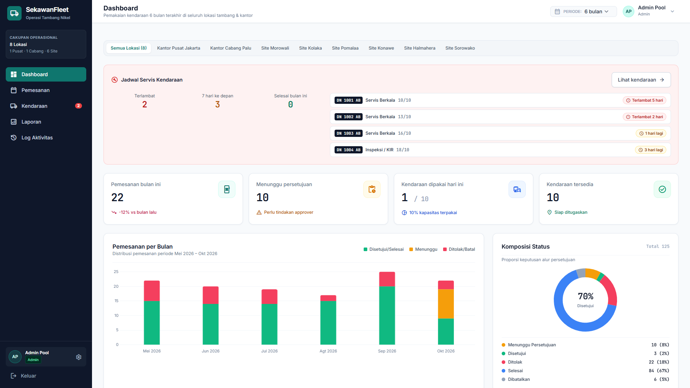 | 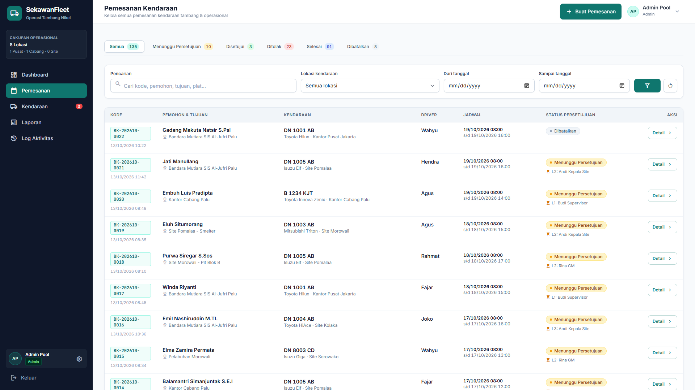 |

| Form Pemesanan | Detail Pemesanan (menunggu persetujuan) |
|---|---|
| 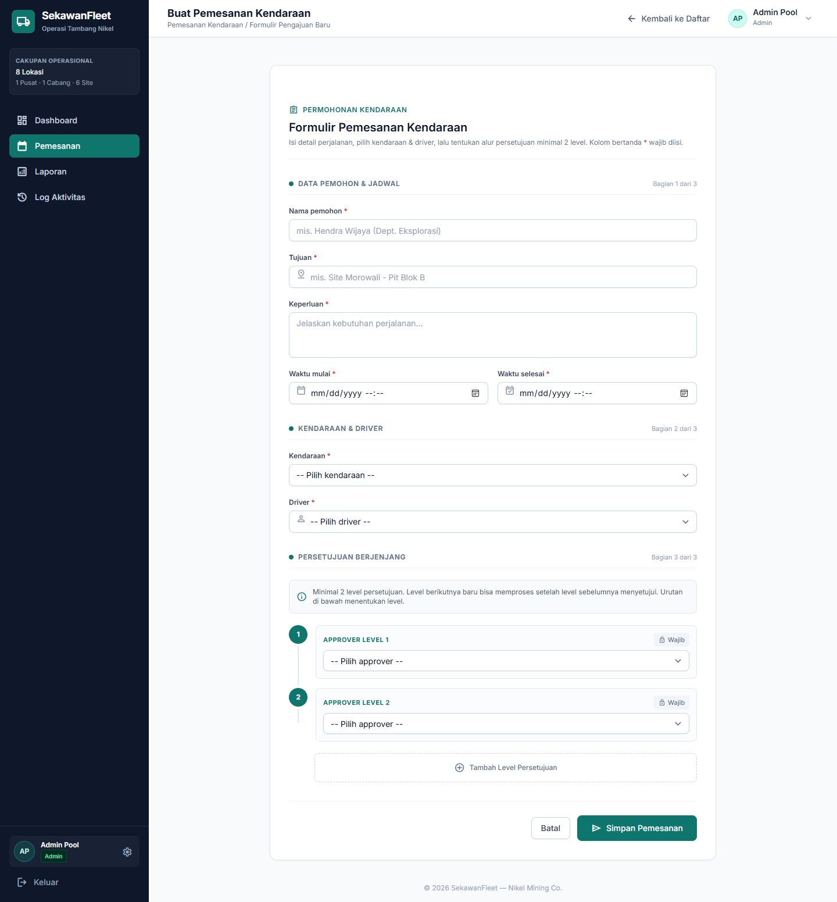 | 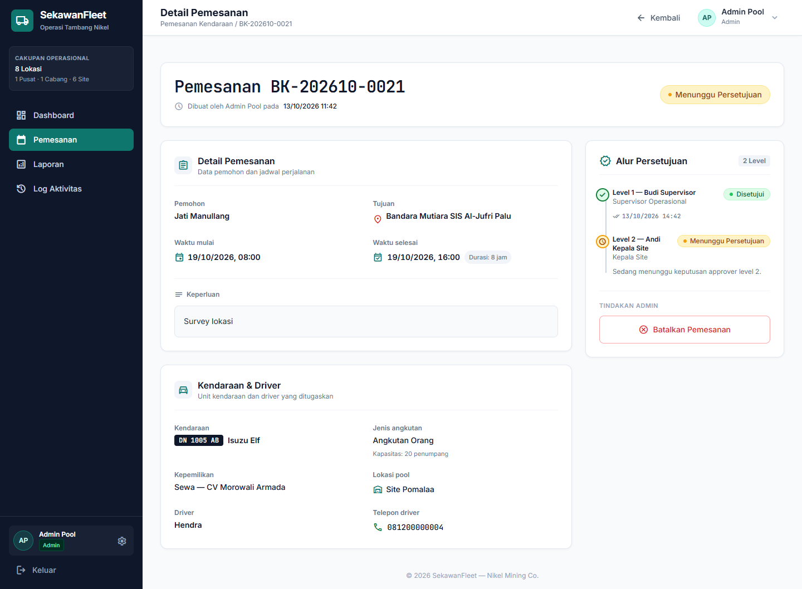 |

| Detail Pemesanan (selesai, dengan riwayat pemakaian) | Laporan & Export Excel |
|---|---|
| 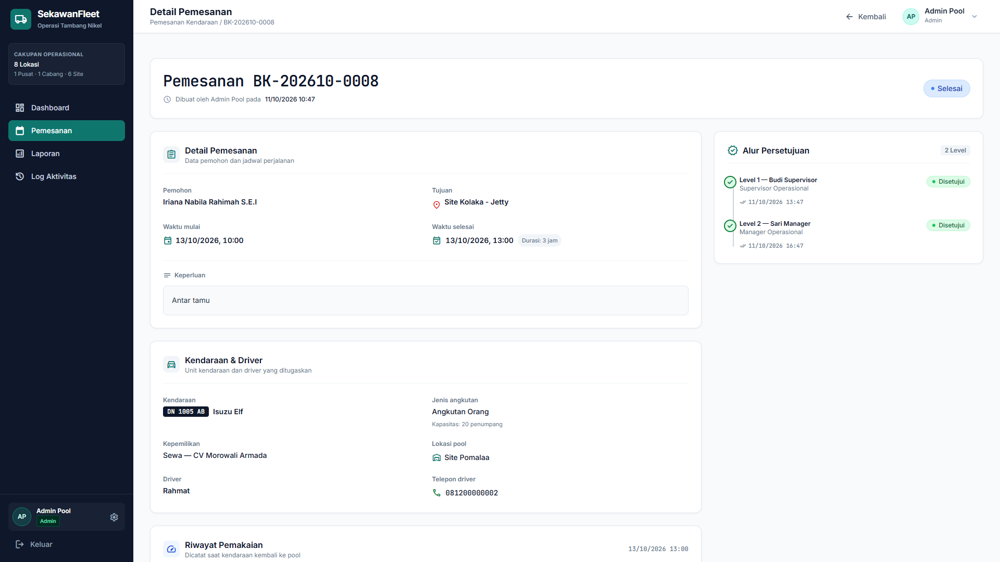 | 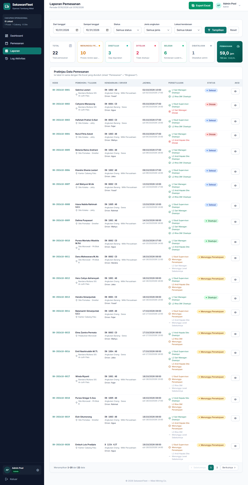 |

| Log Aktivitas |
|---|
| 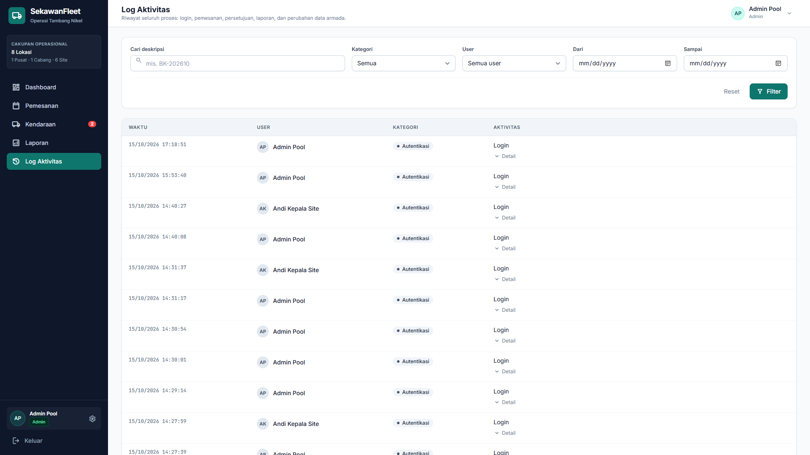 |

| Kendaraan (monitoring & servis berikutnya) | Detail Kendaraan (pemakaian & jadwal servis) |
|---|---|
| 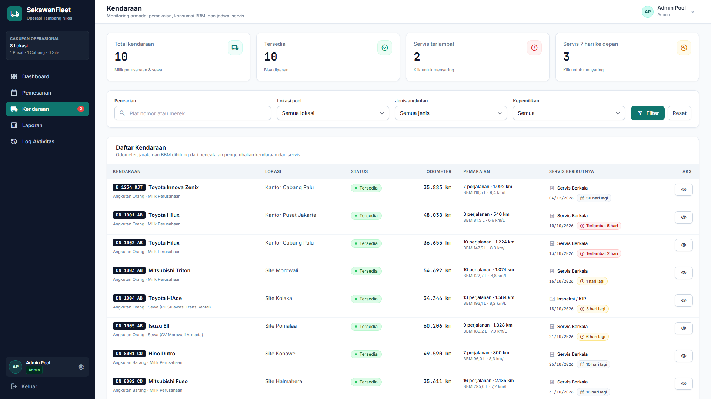 | 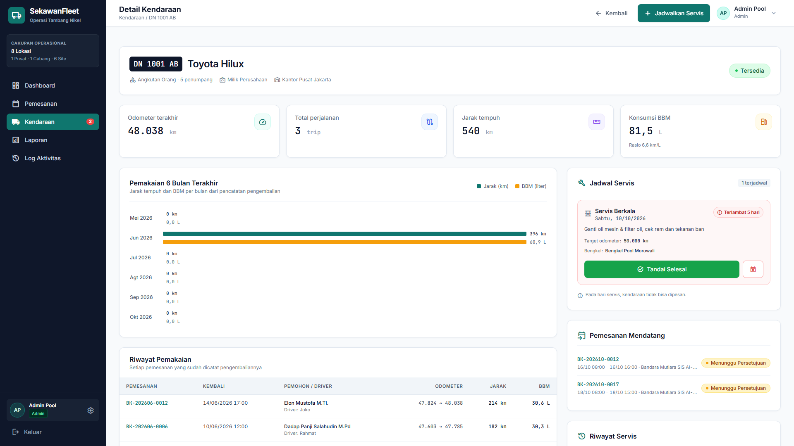 |

### Approver

| Dashboard | Persetujuan Saya | Detail & Keputusan |
|---|---|---|
| 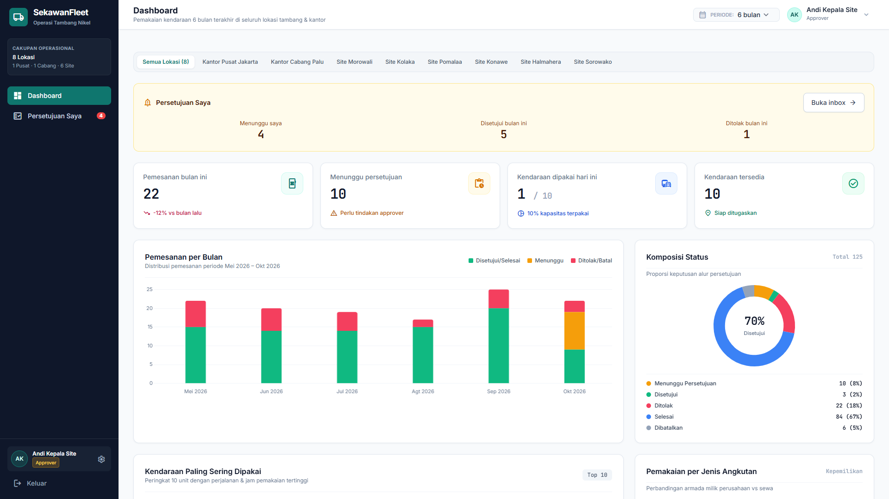 | 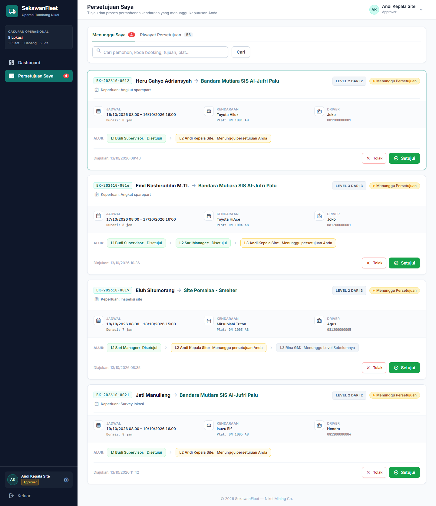 | 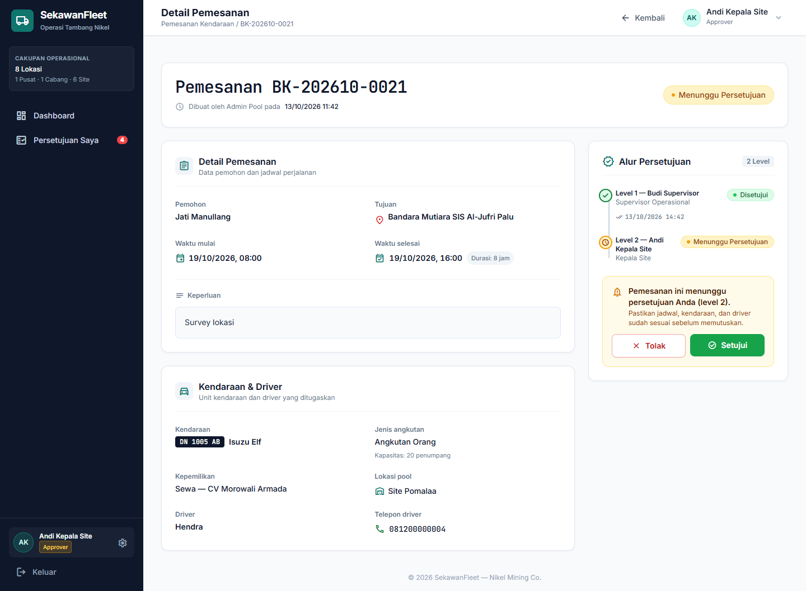 |

## Aturan Bisnis

- Persetujuan berjenjang **2-5 level**, dan approver di setiap level harus orang yang berbeda.
- Level diproses **berurutan**. Satu penolakan di level mana pun membuat seluruh pemesanan *Ditolak*.
- **Tidak boleh bentrok jadwal**: kendaraan atau driver yang sama tidak bisa dipesan pada rentang waktu yang beririsan selama pemesanan masih *Menunggu* atau *Disetujui*. Aturan ini dicek di aplikasi dan dijaga juga oleh constraint `EXCLUDE` di database.
- Hanya kendaraan berstatus *tersedia* dan driver aktif yang bisa dipilih.
- Pembatalan hanya untuk status *Menunggu* atau *Disetujui*.
- Pengembalian hanya untuk status *Disetujui* yang waktu mulainya sudah tiba. Odometer akhir harus ≥ odometer awal, dan waktu kembali harus di antara waktu mulai dan saat ini.
- **Hari servis memblokir pemesanan**: kendaraan tidak bisa dipesan pada rentang waktu yang mencakup tanggal servis terjadwal. Sebaliknya, servis tidak bisa dijadwalkan di hari kendaraan sudah dipesan (*Menunggu*/*Disetujui*), dan satu kendaraan hanya boleh punya satu servis terjadwal per tanggal.
- Servis ditandai **terlambat** kalau tanggalnya sudah lewat tapi belum diselesaikan, dan **segera** kalau jatuh tempo dalam 7 hari. Odometer saat servis tidak boleh lebih kecil dari odometer terakhir yang tercatat.
- Proses persetujuan, pembatalan, pengembalian, dan jadwal servis berjalan di dalam transaksi dengan row lock, sehingga aksi yang bersamaan tidak menghasilkan data ganda.

Siklus status pemesanan:

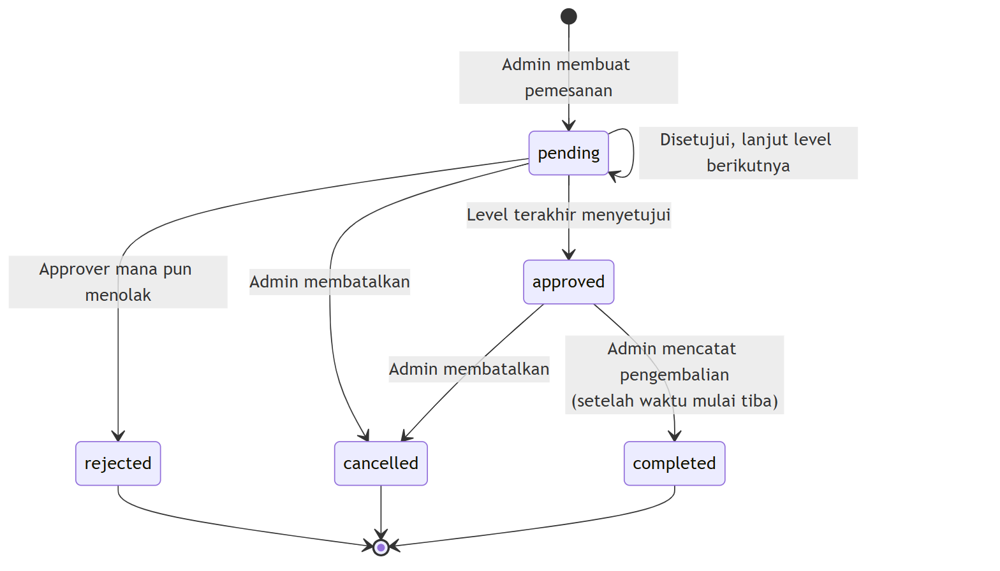

## Physical Data Model

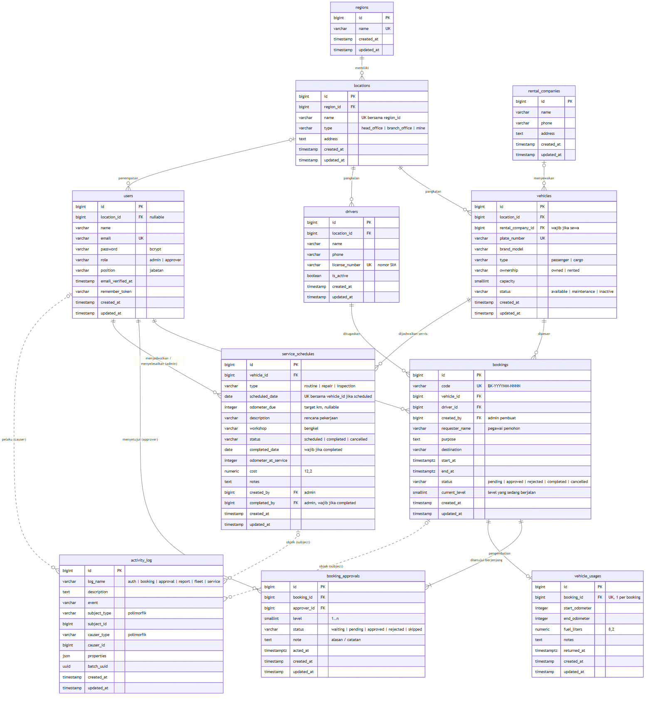

| Tabel | Isi |
|---|---|
| `bookings` | Pemesanan: kode `BK-YYYYMM-NNNN`, kendaraan, driver, admin pembuat, pemohon, jadwal, status, level aktif |
| `booking_approvals` | Persetujuan per level: approver, level, status (`waiting`, `pending`, `approved`, `rejected`, `skipped`), catatan, waktu keputusan |
| `vehicle_usages` | Pengembalian/pemakaian: odometer awal & akhir, BBM, catatan, waktu kembali (maksimal 1 per pemesanan) |
| `service_schedules` | Jadwal servis: kendaraan, jenis (`routine`, `repair`, `inspection`), tanggal, target odometer, bengkel, status (`scheduled`, `completed`, `cancelled`), lalu hasilnya: tanggal selesai, odometer, biaya, catatan |
| `vehicles` | Kendaraan: plat, merek/model, jenis (orang/barang), kepemilikan (milik/sewa), lokasi, perusahaan rental, status |
| `drivers` | Driver: nama, nomor SIM, lokasi, status aktif |
| `users` | Admin & approver: role, jabatan, lokasi |
| `locations`, `regions` | Kantor pusat, kantor cabang, dan tambang per region |
| `rental_companies` | Perusahaan persewaan kendaraan |
| `activity_log` | Log aplikasi (relasi polimorfik ke pelaku dan objek) |

Constraint penting di database:

- `EXCLUDE USING gist (vehicle_id WITH =, tstzrange(start_at, end_at) WITH &&)`, dan aturan yang sama untuk `driver_id`, hanya berlaku untuk status `pending`/`approved`: mencegah jadwal bentrok.
- `UNIQUE (booking_id, level)` dan `UNIQUE (booking_id, approver_id)`: satu approver per level, dan approver tidak boleh dobel dalam satu pemesanan.
- `CHECK (end_at > start_at)`, `CHECK (end_odometer >= start_odometer)`, serta CHECK untuk setiap kolom status/jenis/role.
- `CHECK` kendaraan sewa wajib memiliki `rental_company_id`. Foreign key data master memakai `ON DELETE RESTRICT`.
- `UNIQUE (vehicle_id, scheduled_date) WHERE status = 'scheduled'`: tidak ada dua servis terjadwal untuk kendaraan yang sama di tanggal yang sama. `CHECK` memastikan data penyelesaian (tanggal & penyelesai) terisi jika dan hanya jika status `completed`.

## Activity Diagram

### Umum (Admin & Approver)

**Login**

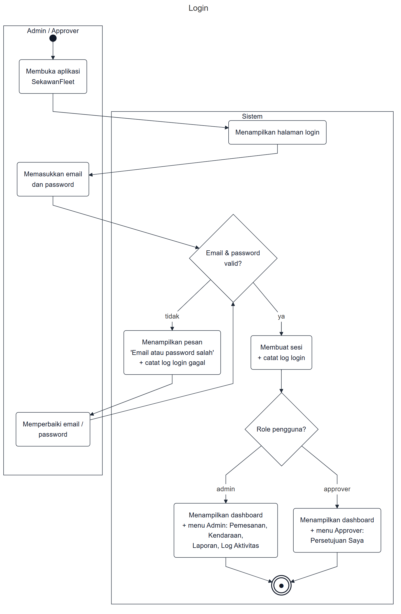

**Melihat Dashboard & Grafik**

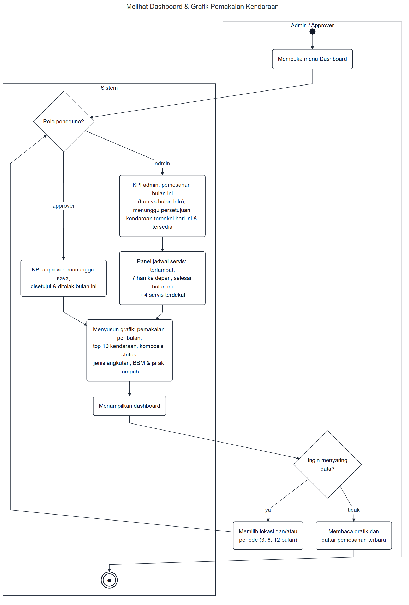

### Admin (Pool Kendaraan)

**Membuat Pemesanan Kendaraan**

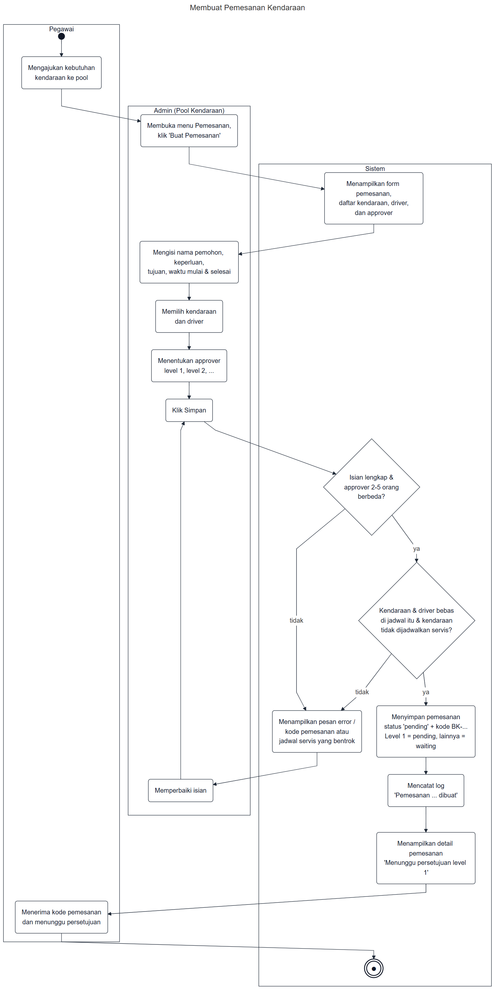

**Membatalkan Pemesanan**

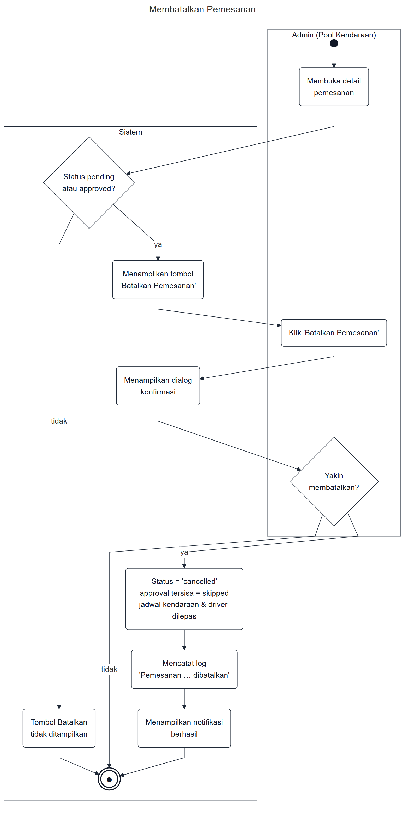

**Mencatat Pengembalian Kendaraan**

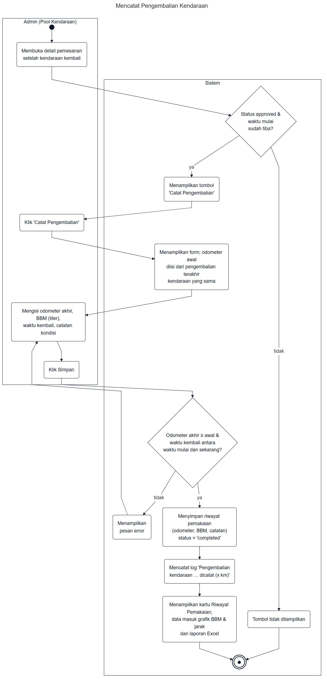

**Laporan Periodik & Export Excel**

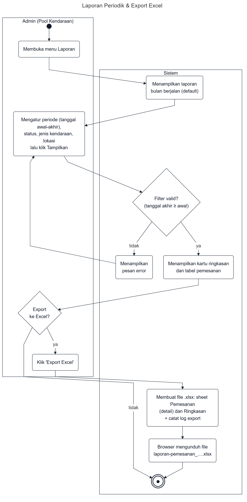

**Melihat Log Aktivitas**

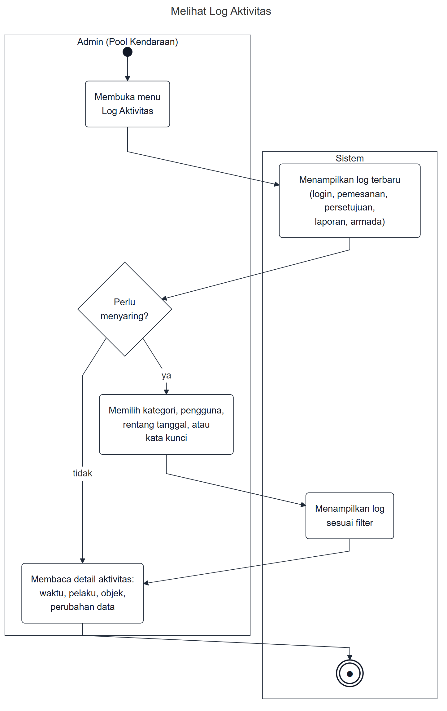

**Monitoring Kendaraan & Menjadwalkan Servis**

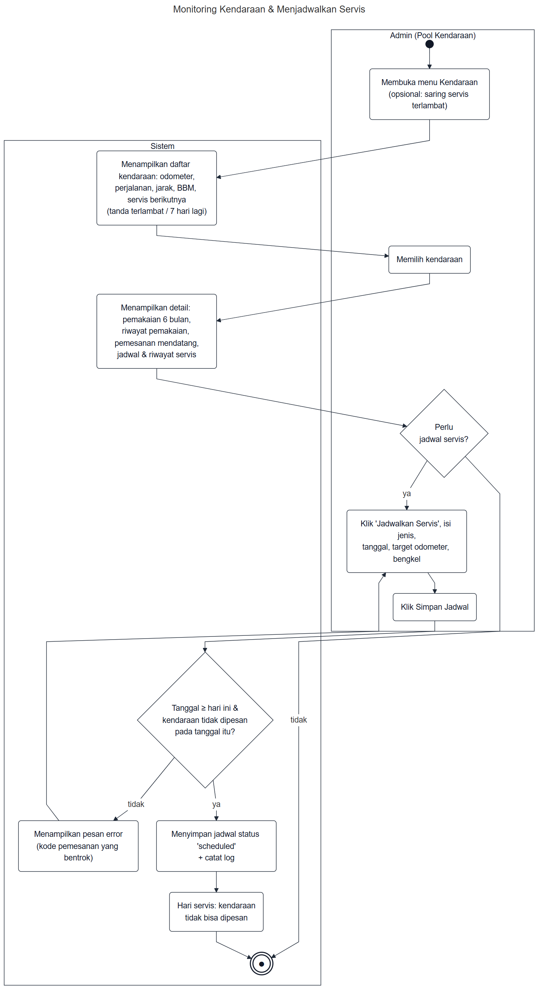

**Menyelesaikan / Membatalkan Servis**

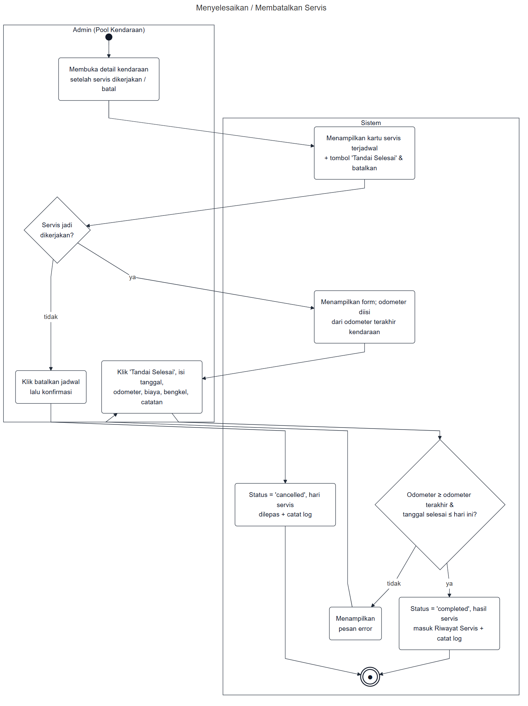

### Approver

**Persetujuan Pemesanan Berjenjang**

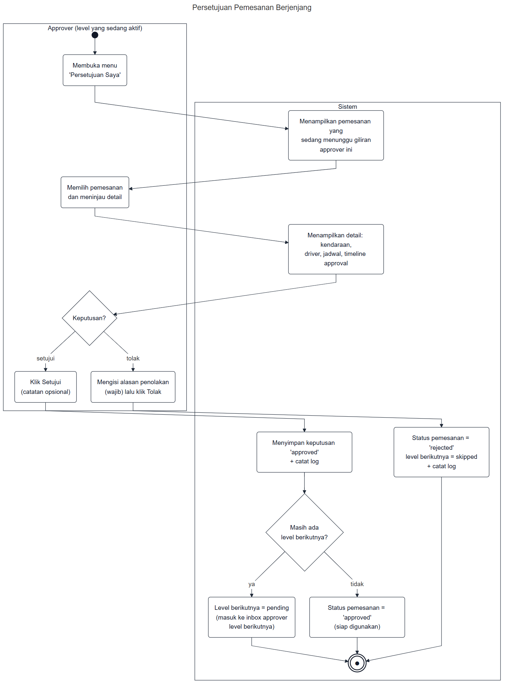

## Log Aplikasi

Setiap proses dicatat dengan [spatie/laravel-activitylog](https://github.com/spatie/laravel-activitylog) ke tabel `activity_log`, lalu disalin ke file harian `storage/logs/activity-YYYY-MM-DD.log` (disimpan 30 hari).

| Proses | Kategori | Contoh |
|---|---|---|
| Login, logout, login gagal | `auth` | Login gagal (hanya email yang dicatat, password tidak pernah disimpan) |
| Membuat pemesanan | `booking` | Pemesanan BK-202610-0012 dibuat |
| Menyetujui / menolak | `approval` | Menyetujui pemesanan BK-202610-0012 (level 1) |
| Membatalkan | `booking` | Pemesanan BK-202610-0012 dibatalkan |
| Mencatat pengembalian | `booking` | Pengembalian kendaraan BK-202610-0012 dicatat (130 km) |
| Menjadwalkan / menyelesaikan / membatalkan servis | `service` | Servis Berkala DN 1001 AB dijadwalkan 20/10/2026 |
| Export laporan | `report` | Export laporan pemesanan ke Excel |
| Perubahan kendaraan / driver | `fleet` | Kendaraan DN 1001 AB diperbarui |

Setiap entri menyimpan pelaku, objek, waktu, serta detail (perubahan atribut, level, keputusan, IP, user agent).

## Pengujian

Test memakai PostgreSQL (database `sekawan_fleet_test`), karena migration memakai `EXCLUDE`, `CHECK`, dan `btree_gist` yang tidak didukung SQLite.

```bash
php artisan test
```

Hasil: **79 test, 350 assertion, semua lulus**. Cakupannya meliputi hak akses per role, validasi pemesanan dan bentrok jadwal, alur persetujuan berjenjang (urutan level, penolakan, keputusan yang tidak bisa diproses dua kali), pembatalan, pengembalian kendaraan, jadwal servis (bentrok dengan pemesanan, penyelesaian, pembatalan, halaman kendaraan), dashboard, laporan & export Excel, serta log aktivitas.

## Batasan

- Data master (kendaraan, driver, lokasi, akun) dikelola lewat seeder. Belum ada halaman CRUD.
- Status kendaraan (*Tersedia*/*Perawatan*/*Tidak Aktif*) tidak berubah otomatis mengikuti jadwal servis. Pemblokiran pemesanan di hari servis dilakukan lewat jadwal servis itu sendiri.
- Notifikasi email belum dikonfigurasi, sehingga fitur reset password tidak ditampilkan. Approver melihat pemesanan baru lewat badge di menu **Persetujuan Saya**.
