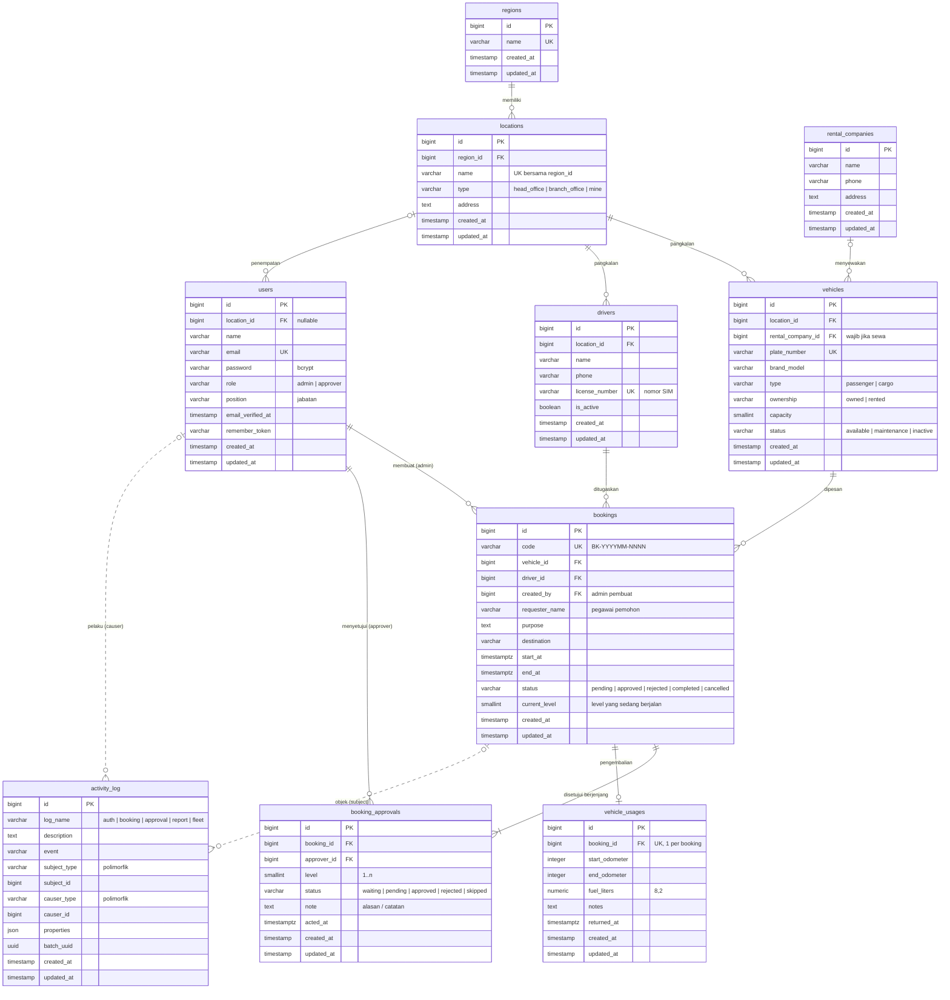

# Physical Data Model — SekawanFleet

Model data fisik untuk fitur pemesanan kendaraan. Database: **PostgreSQL 18** (ekstensi `btree_gist`).
Struktur di bawah diambil langsung dari skema database hasil migration (`database/migrations/`).

Tabel bawaan framework yang tidak berkaitan dengan fitur pemesanan tidak digambar:
`sessions`, `password_reset_tokens`, `cache`, `cache_locks`, `jobs`, `job_batches`, `failed_jobs`, `migrations`.

## Diagram

Versi gambar: [`images/pdm.png`](images/pdm.png) · [`images/pdm.svg`](images/pdm.svg).
Sumber diagram (Mermaid) ada di bawah dan dirender otomatis oleh GitHub.



Garis putus-putus ke `activity_log` adalah relasi polimorfik (`subject_type`/`subject_id`, `causer_type`/`causer_id`), jadi tidak ada foreign key fisik. `subject` bisa berupa booking, kendaraan, atau driver.

## Kamus data

Keterangan: **PK** primary key, **FK** foreign key, **UK** unique. Semua `id` bertipe `bigint` auto increment (identity).

### `regions`: wilayah

| Kolom | Tipe | Null | Keterangan |
|---|---|---|---|
| id | bigint | tidak | PK |
| name | varchar(100) | tidak | UK. Contoh: Sulawesi Tengah |
| created_at, updated_at | timestamp | ya | |

### `locations`: kantor pusat, kantor cabang, dan tambang

| Kolom | Tipe | Null | Keterangan |
|---|---|---|---|
| id | bigint | tidak | PK |
| region_id | bigint | tidak | FK → `regions.id`, ON DELETE RESTRICT |
| name | varchar(100) | tidak | UK bersama `region_id` |
| type | varchar(20) | tidak | CHECK: `head_office`, `branch_office`, `mine` |
| address | text | ya | |
| created_at, updated_at | timestamp | ya | |

### `users`: admin dan approver

| Kolom | Tipe | Null | Keterangan |
|---|---|---|---|
| id | bigint | tidak | PK |
| name | varchar(255) | tidak | |
| email | varchar(255) | tidak | UK, dipakai untuk login |
| email_verified_at | timestamp | ya | |
| password | varchar(255) | tidak | Hash bcrypt |
| remember_token | varchar(100) | ya | |
| location_id | bigint | ya | FK → `locations.id`, ON DELETE SET NULL |
| role | varchar(20) | tidak | CHECK: `admin`, `approver`. Default `approver`. Index |
| position | varchar(100) | ya | Jabatan, ditampilkan di timeline persetujuan |
| created_at, updated_at | timestamp | ya | |

### `rental_companies`: perusahaan persewaan

| Kolom | Tipe | Null | Keterangan |
|---|---|---|---|
| id | bigint | tidak | PK |
| name | varchar(150) | tidak | |
| phone | varchar(30) | ya | |
| address | text | ya | |
| created_at, updated_at | timestamp | ya | |

### `vehicles`: kendaraan

| Kolom | Tipe | Null | Keterangan |
|---|---|---|---|
| id | bigint | tidak | PK |
| location_id | bigint | tidak | FK → `locations.id`, ON DELETE RESTRICT |
| rental_company_id | bigint | ya | FK → `rental_companies.id`, ON DELETE RESTRICT |
| plate_number | varchar(20) | tidak | UK |
| brand_model | varchar(100) | tidak | Contoh: Toyota Hilux |
| type | varchar(20) | tidak | CHECK: `passenger` (angkutan orang), `cargo` (angkutan barang) |
| ownership | varchar(20) | tidak | CHECK: `owned`, `rented` |
| capacity | smallint | ya | Kapasitas penumpang |
| status | varchar(20) | tidak | CHECK: `available`, `maintenance`, `inactive`. Default `available` |
| created_at, updated_at | timestamp | ya | |

Index: (`location_id`, `status`).
CHECK `chk_vehicle_rental`: kendaraan sewa wajib punya `rental_company_id`, dan kendaraan milik perusahaan wajib tidak punya.

### `drivers`: pengemudi

| Kolom | Tipe | Null | Keterangan |
|---|---|---|---|
| id | bigint | tidak | PK |
| location_id | bigint | tidak | FK → `locations.id`, ON DELETE RESTRICT |
| name | varchar(100) | tidak | |
| phone | varchar(30) | ya | |
| license_number | varchar(30) | tidak | UK, nomor SIM |
| is_active | boolean | tidak | Default `true` |
| created_at, updated_at | timestamp | ya | |

### `bookings`: pemesanan kendaraan

| Kolom | Tipe | Null | Keterangan |
|---|---|---|---|
| id | bigint | tidak | PK |
| code | varchar(20) | tidak | UK. Format `BK-YYYYMM-NNNN` |
| vehicle_id | bigint | tidak | FK → `vehicles.id`, ON DELETE RESTRICT |
| driver_id | bigint | tidak | FK → `drivers.id`, ON DELETE RESTRICT |
| created_by | bigint | tidak | FK → `users.id` (admin pembuat), ON DELETE RESTRICT |
| requester_name | varchar(100) | tidak | Nama pegawai yang mengajukan ke pool |
| purpose | text | tidak | Keperluan |
| destination | varchar(150) | tidak | Tujuan |
| start_at | timestamptz | tidak | Waktu berangkat. Index |
| end_at | timestamptz | tidak | Waktu kembali (rencana). CHECK `end_at > start_at` |
| status | varchar(20) | tidak | CHECK: `pending`, `approved`, `rejected`, `completed`, `cancelled`. Default `pending`. Index |
| current_level | smallint | tidak | Level persetujuan yang sedang berjalan. Default 1 |
| created_at, updated_at | timestamp | ya | |

Constraint anti-bentrok jadwal (butuh `btree_gist`):

```sql
-- Kendaraan yang sama tidak boleh dipesan pada rentang waktu yang beririsan
EXCLUDE USING gist (vehicle_id WITH =, tstzrange(start_at, end_at) WITH &&)
    WHERE (status IN ('pending', 'approved'));

-- Driver yang sama tidak boleh ditugaskan pada rentang waktu yang beririsan
EXCLUDE USING gist (driver_id WITH =, tstzrange(start_at, end_at) WITH &&)
    WHERE (status IN ('pending', 'approved'));
```

Booking yang ditolak, dibatalkan, atau sudah selesai tidak lagi mengunci jadwal.

### `booking_approvals`: persetujuan berjenjang

| Kolom | Tipe | Null | Keterangan |
|---|---|---|---|
| id | bigint | tidak | PK |
| booking_id | bigint | tidak | FK → `bookings.id`, ON DELETE CASCADE |
| approver_id | bigint | tidak | FK → `users.id`, ON DELETE RESTRICT |
| level | smallint | tidak | CHECK `level >= 1` |
| status | varchar(20) | tidak | CHECK: `waiting`, `pending`, `approved`, `rejected`, `skipped`. Default `waiting` |
| note | text | ya | Catatan atau alasan penolakan |
| acted_at | timestamptz | ya | Waktu approver mengambil keputusan |
| created_at, updated_at | timestamp | ya | |

Constraint:
- UNIQUE (`booking_id`, `level`): satu approver per level.
- UNIQUE (`booking_id`, `approver_id`): orang yang sama tidak boleh menyetujui dua level di booking yang sama.
- Index (`approver_id`, `status`) untuk inbox "Persetujuan Saya".

Arti status:

| Status | Arti |
|---|---|
| `waiting` | Level sebelumnya belum selesai |
| `pending` | Giliran approver ini |
| `approved` / `rejected` | Sudah diputuskan |
| `skipped` | Dilewati, karena level sebelumnya menolak atau booking dibatalkan |

Jumlah level minimal 2 dan maksimal 5. Aturan ini dijaga di validasi aplikasi (`StoreBookingRequest`).

### `vehicle_usages`: pengembalian dan pemakaian kendaraan

| Kolom | Tipe | Null | Keterangan |
|---|---|---|---|
| id | bigint | tidak | PK |
| booking_id | bigint | tidak | FK → `bookings.id`, ON DELETE CASCADE. UK, maksimal 1 per booking |
| start_odometer | integer | tidak | km |
| end_odometer | integer | ya | km. CHECK `end_odometer IS NULL OR end_odometer >= start_odometer` |
| fuel_liters | numeric(8,2) | ya | BBM yang dipakai (liter) |
| notes | text | ya | Kondisi kendaraan saat kembali |
| returned_at | timestamptz | ya | Waktu kembali aktual |
| created_at, updated_at | timestamp | ya | |

Data tabel ini dipakai oleh grafik "Konsumsi BBM & Jarak Tempuh" di dashboard dan oleh kolom Jarak/BBM di laporan Excel.

### `activity_log`: log aplikasi (spatie/laravel-activitylog)

| Kolom | Tipe | Null | Keterangan |
|---|---|---|---|
| id | bigint | tidak | PK |
| log_name | varchar(255) | ya | `auth`, `booking`, `approval`, `report`, `fleet`. Index |
| description | text | tidak | Contoh: "Menyetujui pemesanan BK-202610-0012 (level 1)" |
| event | varchar(255) | ya | `login`, `created`, `approved`, `completed`, dan seterusnya |
| subject_type, subject_id | varchar, bigint | ya | Objek yang dikenai aksi (polimorfik). Index |
| causer_type, causer_id | varchar, bigint | ya | User pelaku (polimorfik). Index |
| properties | json | ya | Detail: perubahan atribut, level, keputusan, IP, user agent |
| batch_uuid | uuid | ya | |
| created_at, updated_at | timestamp | ya | |

Setiap entri juga disalin ke file harian `storage/logs/activity-YYYY-MM-DD.log`, yang disimpan selama 30 hari.

## Aturan integritas di level database

| Aturan | Mekanisme |
|---|---|
| Kendaraan dan driver tidak bisa dipesan dobel | `EXCLUDE USING gist` di `bookings` |
| Waktu selesai harus setelah waktu mulai | CHECK `chk_booking_period` |
| Nilai status, role, dan jenis selalu valid | CHECK di setiap kolom enum |
| Kendaraan sewa wajib terhubung ke perusahaan rental | CHECK `chk_vehicle_rental` |
| Satu level satu approver, approver tidak dobel | UNIQUE di `booking_approvals` |
| Odometer tidak bisa mundur | CHECK `chk_usage_odometer` |
| Satu booking hanya punya satu catatan pengembalian | UNIQUE `vehicle_usages.booking_id` |
| Data master tidak bisa dihapus selama masih dipakai | FK ON DELETE RESTRICT |
| Approval dan pemakaian ikut terhapus bersama booking | FK ON DELETE CASCADE |
